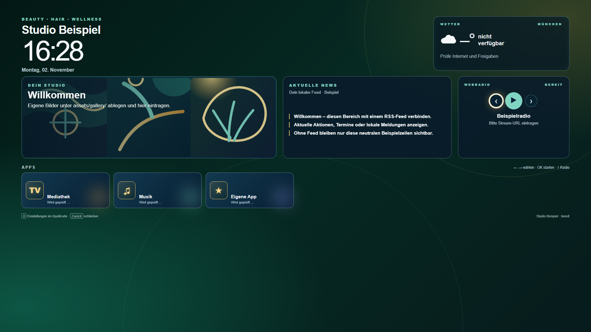

# Tizen Service Dashboard

Ein werbefreies, fernbedienungsoptimiertes Dashboard für Samsung Smart TVs mit Tizen. Gedacht für Nagelstudios, Friseursalons, Kosmetik, Praxen, Wartebereiche und andere Dienstleister.

Es zeigt Uhrzeit, Wetter, optionale RSS-Schlagzeilen, Webradio, installierte TV-Apps, erkannte HDMI-Eingänge und eine lokale Bildergalerie. Branding und Inhalte liegen in einer einzigen Konfigurationsdatei.



> Dieses Repository enthält keine Kundenfotos, Zugangsdaten, Anbieterlogos, Streaming-App-IDs oder fremde Medien. Marken und Inhalte gehören ihren jeweiligen Inhabern.

## Funktionen

- 1920×1080-UI mit automatischer Skalierung
- D-Pad-Navigation: Pfeiltasten, OK/Enter und Zurück
- Wetter via Open-Meteo ohne API-Key
- RSS-Schlagzeilen mit optionalem CORS-Proxy
- Konfigurierbares Webradio; Hardware-Play/Pause und Vor/Zurück
- Start installierter Tizen-Apps mit Fehlerbehandlung
- Erkennung und Umschalten verbundener HDMI-Eingänge
- Lokale, zufällig gemischte Galerie
- Neutrales CSS-Theme `golden-night` mit optionalen goldenen Kachelsymbolen
- Keine Telemetrie, kein Backend und keine Werbung

## Schnellstart unter Windows

1. [Tizen Studio](https://developer.tizen.org/development/tizen-studio/download) installieren.
2. Im Package Manager **TV Extensions** und **Samsung Certificate Extension** installieren.
3. Im Certificate Manager ein Samsung-TV-Zertifikat erstellen. Die DUID des TVs wird dabei abgefragt.
4. Auf dem TV den Entwickler-Modus aktivieren, die IP des PCs eintragen und den TV neu starten.
5. In [`config.xml`](config.xml) `YOURPKG123` durch die zehnstellige Package-ID des Zertifikats ersetzen.
6. [`js/dashboard.config.js`](js/dashboard.config.js) für Studio, Standort, RSS, Radio, Apps, HDMI und Galerie anpassen. Details: [Konfiguration](docs/CONFIGURATION.md).
7. In PowerShell aus dem Projektordner bauen und auf den TV installieren:

```powershell
$env:TV_IP = "192.168.178.77"
$env:CERTIFICATE_PROFILE = "DeinZertifikatsprofil"
$env:APP_ID = "DEINEPACKAGEID.ServiceDashboard"
.\build-install.bat
```

Bei einer Standardinstallation liegt Tizen Studio unter `C:\tizen-studio`. Bei einem anderen Ort zusätzlich setzen:

```powershell
$env:TIZEN_HOME = "D:\Tools\tizen-studio"
```

## Projektstruktur

```text
Tizen-Service-Dashboard/
├── assets/
│   ├── gallery/                 # eigene Bilder, standardmäßig nicht versioniert
│   └── icon.svg
├── css/dashboard.css
├── docs/
│   ├── CONFIGURATION.md
│   └── TROUBLESHOOTING.md
├── js/
│   ├── dashboard.config.js      # alle sichtbaren Inhalte
│   └── main.js                  # Tizen-/Dashboard-Logik
├── build-install.bat
├── config.xml
└── index.html
```

## Sicherheits- und Lizenzhinweise

- Ein WGT ist kein sicherer Ort für Passwörter, private Kalender oder API-Keys.
- Der Standardzugriff in `config.xml` erlaubt frei konfigurierbare HTTPS-Endpunkte. Für einen produktiven Einsatz solltest du ihn auf die tatsächlich verwendeten Domains einschränken.
- Prüfe die Nutzungsrechte von Fotos, Streams, RSS-Inhalten und Marken selbst.
- Dieses Projekt steht unter der [MIT-Lizenz](LICENSE).

## Mitwirken

Fehlerberichte und Verbesserungen sind willkommen. Bitte keine Zugangsdaten, Kundenfotos, urheberrechtlich geschützten Logos oder nicht freigegebene Streams in Issues oder Pull Requests veröffentlichen.

